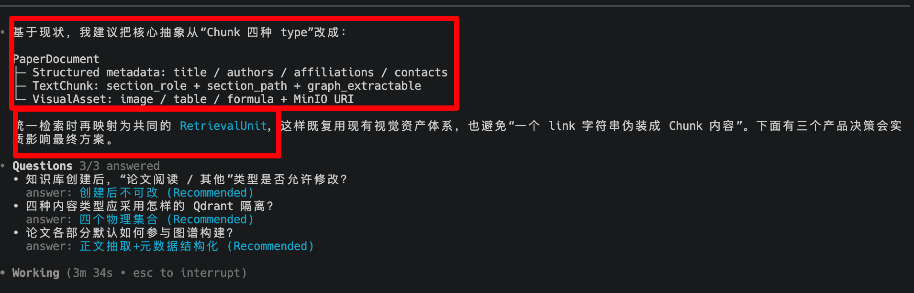

为论文阅读领域还实现了垂域适配

不仅要从设计层斟酌，具体实现还要深思熟虑（既然是试验性功能，那么就不该颠覆整个代码结构设计，而是封装一层(PaperDocument)，并能在关键、合适的时机映射转换到旧代码中的设计和实现[RetrievalUnit]）

初步方案：
```markdown

  # 论文阅读知识库：MinerU 保真解析与领域智能分块

  ## Summary

  新增实验性知识库类型：

  - general：保持现有行为。
  - paper_reading：创建后不可修改，仅接受 PDF，强制使用 MinerU，不允许用户选择 Chunking Strategy。
  - 现有知识库迁移后统一视为 general，不做历史数据回填。

  处理链路：

  PDF
   │
   ▼
  MinerU
   ├─ Canonical Markdown ──► MinIO parsed bucket
   ├─ content_list / manifest ──► MinIO audit artifact
   └─ image/table/formula ──► MinIO visual assets
              │
              ▼
  论文结构识别
   规则优先 + 低置信度 LLM 兜底
              │
       ┌──────┴─────────────┐
       ▼                    ▼
  论文元数据               长内容 Section
  title/team/reference/ack  abstract/body/appendix
       │                    │
  Postgres 确定性读取       智能分块
                            │
                text/image/table/formula
                   四个 Qdrant collections

  ## Key Changes

  ### 1. 领域模型与持久化

  - KnowledgeBase 增加不可变字段 knowledge_type: general | paper_reading；创建接口和前端类型同步增加该字段。
  - 不把四种内容强行塞进同一个 Chunk 表：
      - KnowledgeChunk 只表示文本检索单元。
      - KnowledgeVisualAsset 继续表示图片、表格、公式及真实 MinIO 对象。
      - 检索层增加统一 RetrievalUnit DTO，content_kind 为 text | image | table | formula。

  - KnowledgeChunk 增加：
      - paper_section_id
      - section_role
      - section_path_json
      - graph_extractable
      - retrieval_enabled
      - 页码、Markdown 字符偏移和分类置信度元数据

  - 不单独存储 is_metadata；由 section_role 推导。metadata_type 统一替换为可扩展的 section_role。
  - 新增论文领域表：
      - KnowledgePaperDocument：标题、作者、单位、联系方式、Acknowledgements、解析器/分类器版本和置信度。
      - KnowledgePaperSection：层级、标题路径、角色、顺序、Markdown/Page 偏移、分类来源。
      - KnowledgePaperReference：按顺序保存每条参考文献原文及可选结构化字段。
      - KnowledgeIndexChannel：记录 text/image/table/formula 四个 collection 的名称、状态、point count 和 embedding profile。

  - 默认角色策略：
      - abstract、body：可检索、可构建图谱。
      - appendix、unknown：可检索、默认不构建图谱。
      - title、team、acknowledgements、references：作为结构化元数据保存，不进入向量库，不送实体关系抽取。

  - title/team 本期不自动写入知识图谱；为后续确定性论文元数据图谱适配器保留结构化数据。

  ### 2. MinerU 保真解析

  - 将 MinerU 返回值从单纯 VisualScanResult 扩展为 ParsedDocumentArtifact，包含：
      - canonical Markdown
      - content list
      - 结构化 block/source map
      - visual assets
      - parser manifest

  - 修复当前只查找 full.md 的限制：
      - 优先选择与源文件 stem 匹配的 Markdown。
      - 其次选择 MinerU 输出中最大的主 Markdown。
      - 找不到 Markdown 时，依据 content_list.json 的 text_level、list、table、equation、image 信息重建 Markdown。

  - canonical Markdown 原样写入 MINIO_BUCKET_KB_PARSED：
      - {kb_id}/{file_id}/{source_hash}/document.md
      - 同目录保存 manifest.json 和 content_list.json
      - KnowledgeFile.parsed_storage_uri 指向 document.md

  - 论文库 MinerU 采用 fail-closed：
      - MinerU 未配置、超时、输出缺失或 Markdown 无法校验时，文件进入 error。
      - 不回退到普通 PDF 文本解析。

  - 一般知识库继续使用现有解析与 fallback，不受影响。
  - 分享、导入、删除和清理流程同步管理 parsed Markdown、manifest 和 visual objects 的所有权。

  ### 3. 论文结构识别与智能分块

  - 使用 Markdown AST 解析标题、段落、列表、代码块、表格、公式和资源链接；引入 markdown-it-py，避免把代码块内的 # 误判为标题。
  - 结构识别分两阶段：
      - 确定性规则：H1 标题、首个 H2 前 front matter、Abstract/Acknowledgements/References 同义词、编号标题、Appendix/Supplementary、A
        Implementation Details 等字母附录模式和章节位置。

      - LLM 兜底：只传论文大纲和 front matter；仅在角色或作者—单位绑定低置信度时调用一次结构化 LLM。

  - 低置信度无法解决的章节标为 unknown：允许普通检索，但默认不进入图谱，避免错误抽取。
  - 智能分块规则固定为 paper_outline_v1，用户不可修改：
      - 先按 H2/H3 叶子章节切分。
      - 超长叶子章节按 Markdown block/段落继续切分。
      - 单个不可分 block 超限时才按句子切分。
      - 不跨 section overlap；仅同一叶子章节内保留 80-token overlap。
      - 目标 800 tokens，硬上限 1200 tokens。
      - 小于 120 tokens 的相邻文本块仅在同一 section 内合并。
      - 代码块、表格、公式和资源 anchor 不从中间切断公式中的 # 被误判；引入 markdown-it-py。

  - 结构识别采用“规则优先、LLM 兜底”：
      - H1 作为论文标题；
      - H1 与第一个 H2 之间作为 team/front matter；
      - 标准 Abstract、Acknowledgements、References 走确定性规则；
      - Appendix、Supplementary、单字母章节如 A Implementation Details 结合编号和文档位置识别为 Appendix；
      - 仅低置信度大纲和作者—单位绑定调用一次结构化 LLM；
      - 无法确认的章节标为 unknown，保留检索但默认不进图谱。

  - 固定智能分块参数：
      - 目标 800 tokens，硬上限 1200 tokens；
      - 同一叶子章节内部允许 80-token overlap；
      - 不跨章节 overlap；
      - 优先按 H2/H3 和 Markdown block 分割；
      - 缺失 H3 时按段落、列表、代码块边界拆分；
      - 超大不可分 block 最后才按句子切分；
      - stored content 保持原文，embedding text 额外加入论文标题和 section path。

  - 默认策略：
      - abstract/body: retrieval_enabled=true、graph_extractable=true；
      - appendix: retrieval_enabled=true、graph_extractable=false；
      - unknown: retrieval_enabled=true、graph_extractable=false；
      - title/team/acknowledgements/references 不生成向量 Chunk，保存为确定性论文元数据。

  - References 按条结构化保存；Acknowledgements 保存完整文本。未来问答路由到具体论文后直接读取，不经过向量召回。
  - Appendix 仍是长内容，按章节分块进入 text collection；未来可限定 file_id + section_role=appendix 做论文内检索。
  - 图谱构建只加载 graph_extractable=true 的 Chunk；现有 Span 内容路由继续作为第二层安全过滤。

  ## Indexing And APIs

  - 论文索引创建四个 Collection：
      - _text：Abstract、正文、Appendix、unknown；
      - _image：caption、VLM description、附近标题的文本代理；
      - _table：caption、标准化表格文本和附近标题；
      - _formula：caption、LaTeX 和附近标题。

  - 四个 Collection 初期可共用当前 embedding profile，但独立保存 profile 和构建版本，允许后续按模态替换。
  - Qdrant payload 包含 file_id、section_role、section_path、页码及资产 ID；不直接暴露 MinIO URI。
  - 检索层优先读取 KnowledgeIndexChannel；普通旧索引回退到现有 text + unified visual 指针。
  - 新增/调整公共接口：
      - 创建知识库增加 knowledge_type；
      - 知识库响应返回类型和有效智能分块策略；
      - 论文库上传接口忽略客户端分块参数并强制 PDF；
      - 提供鉴权后的 canonical Markdown 查看/下载接口；
      - 提供论文元数据接口，支持 title/team/acknowledgements/references；
      - References 接口分页返回；
      - 文件响应返回论文标题、作者数、参考文献数、结构识别状态和警告；
      - 索引响应返回四个 channel 的状态与点数。

  - 创建页面增加“论文阅读 / 其他”选择；论文阅读模式：
      - 显示“实验性、仅 PDF、依赖 MinerU”提示；
      - 隐藏语言、Chunk Strategy、大小、overlap 等控件；
      - 上传控件只接受 PDF；
      - 文件详情可查看论文元数据和 canonical Markdown；
      - 索引 UI 展示四个 channel 的构建状态。

  - 分享、导入和删除流程同步处理 parsed Markdown、manifest、论文元数据、Section、Reference 和四个 Collection。

  ## Test Plan

  - 使用 mineru_example/extract_define_canonicalize 作为核心 fixture，验证：
      - 能发现非 full.md 命名的 Markdown；
      - Markdown 原样写入 MinIO 并可校验哈希；
      - 正确识别标题、作者、单位、联系方式；
      - 正确分类 Abstract、正文、Acknowledgements、References；
      - A 到 G 的二级标题识别为 Appendix；
      - 缺失三级标题时仍按 block 和 token 上限稳定拆分。

  - 验证 References 逐条保存、Acknowledgements 确定性读取，二者不进入 Qdrant。
  - 验证 Appendix 进入 text collection，但不进入图谱抽取。
  - 验证 unknown 章节保留检索、默认不进图谱，并记录低置信度审计。
  - 验证四个 Collection 独立命名、点数、所有权、删除与重建。
  - 验证图片、表格、公式通过资产 ID 二次获取真实内容。
  - 验证论文库拒绝伪 PDF、MinerU 不可用时 fail-closed，不回退普通解析。
  - 验证普通知识库和旧索引行为不变。
  - 前端验证类型选择、论文模式控件隐藏、PDF 限制、元数据展示和四 channel 状态。
  - 完成后运行相关后端测试、完整前端生产构建及一次真实样例端到端摄取审计。

  ## Assumptions

  - 该版本不实现未来的问答路由算法，只提供确定性论文元数据接口和 Appendix 限域检索基础

```


